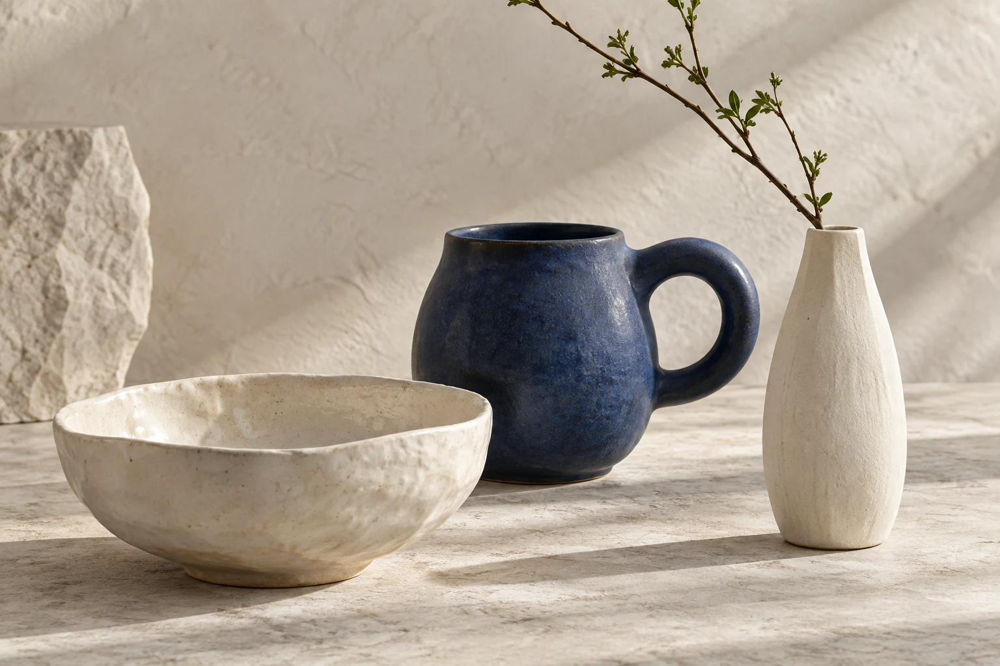
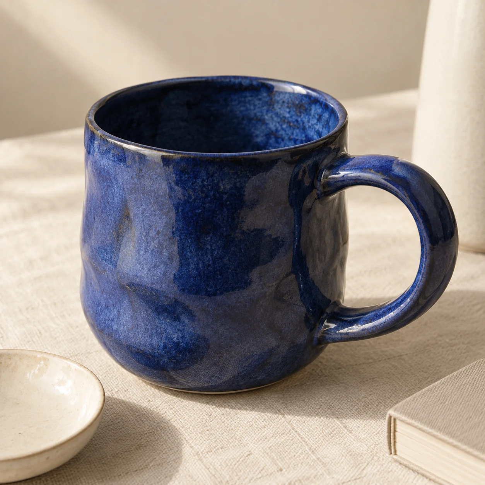
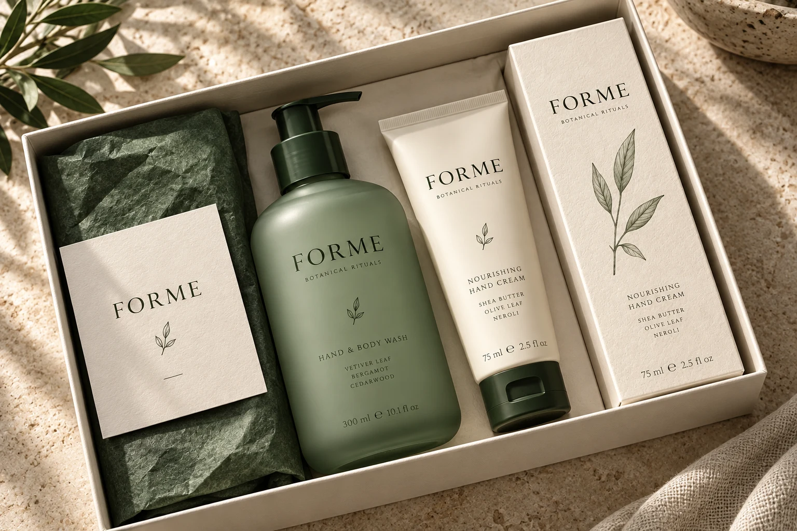

# 메인 1·4 교정 디자인 기준 — 2026-09-29

구현 담당: Astra / xhigh. 품질 승인 전 설계이며 독립 Sol 검토는 별도입니다. 소유 범위는 메인1 3개 진입 PHP·home-one CSS/TS, 메인4 PHP·home-four CSS/entry TS입니다. 기존 dirty 파일은 보존합니다.

## 선택 이유와 기준 장면

메인1은 한 기업이 제공하는 서비스의 폭을 서로 다른 매체로 보여줍니다. 메인4는 FORME 한 브랜드를 끝까지 따라가며 작업 과정을 증명합니다. 첫 화면과 기존 좋은 사진을 유지하고, 자료 밀도가 낮은 장면만 교체합니다.

기존 전체 흐름: [메인1](../../output/qa/main-seven-improvement-20260928/final/boards/home-1-desktop-light.png), [메인4](../../output/qa/main-seven-improvement-20260928/final/boards/home-4-desktop-light.png). 2026-09-28 자료는 기존 상태를 이해하는 참고이며 현재 통과 증거가 아닙니다.

새 실제 자산을 넣은 [기준 화면 HTML](../prototypes/seven-home14-direction-2026-09-29.html)을 먼저 작성하고 같은 구성으로 구현합니다. 제품 사진은 완성 시안 내부에만 쓰며 UI의 색상은 현재 daisyUI와 DTCG를 따릅니다.

## 메인1 섹션 지도

| 순서·역할 | 실제 자료·구도 | PC / 모바일·배경·동작 |
| --- | --- | --- |
| 1 첫 인상 | 기존 전략·디지털·브랜드 3장 | 전폭 사진 700px / 기존 모바일 크롭; Embla 수동·재생·키보드 보존 |
| 2 지원 범위 | 3개 중앙 대형 서비스 아이콘 | 가로 3열 / 세로 3행; paper 표면, 아이콘에만 회전 |
| 3 업종 차이 | 도자기 작업 사진·전문 서비스 모자이크 | 비대칭 / 세로; base-100, 기존 사진 유지 |
| 4 판단의 근거 | ATELIER 쇼룸 방문자의 질문 → 선택 결정 기록 3행 | 설명+실제 편집 보드 / 보드 1열; deep 바탕, 스크롤이 질문과 선택의 같은 행을 연결 |
| 5 작업 순서 | 기존 4단계 레일 | 4열 / 세로; paper, 진행선 유지 |
| 6 디지털 결과 | ATELIER 컬렉션 PC 시안+청색 머그 모바일 상세 | 큰 화면과 겹친 휴대폰 / 컬렉션 다음 상세; soft 표면, 실제 제품 정보·탐색 순서 |
| 7 사례 차이 | 기존 F&B·교육 사진+DAYLINE 일정 화면 | 비대칭 모자이크 / 세로; 완성 일정·회의 정보가 있는 디지털 자료 |
| 8 브랜드 촉감 | 기존 브랜드 인쇄물 사진 | 사진·설명 분할 / 세로; brand 표면 유지 |
| 9 표현 시스템 | 형태·타이포·색상 보드 | 기존 자료 구도 / 모바일 작은 글자 보정 |
| 10 질문 | 4개 FAQ+협업 준비 메모 | 소개·FAQ 2열 / 1열; base-100, 질문 첫 항목 펼침 |
| 11 최신 소식 | 실제 G5 latest | 1열 목록; paper, 현재 설정 게시판 유지 |
| 12 다음 행동 | 프로젝트 출발점 3가지 체크+문의 | 내용·행동 2열 / 세로; deep, 본문과 실제 문의 분리 |

M1-01: 일반 원·선 대신 관찰 근거, 선택 전후, 우선/보류 이유가 있는 보드. M1-02: ATELIER 브랜드·작품 정보·컬렉션 탐색과 모바일 세부 설명. M1-03: DAYLINE의 실제 하루 일정과 프로젝트 상태. M1-04: FAQ 준비 메모와 실사용 문의 체크로 후반 구성 차별화. 12개 section과 3개 hero slide 보존.

## 메인4 섹션 지도

| 순서·역할 | 실제 자료·구도 | PC / 모바일·배경·동작 |
| --- | --- | --- |
| 1 프로젝트 커버 | 기존 FORME 제품 사진 | 사진·설명 2열 / 세로; base-100 |
| 2 과정 개요 | 중앙 Lucide 4개 | 4열 / 2열; soft, 제목 정렬·아이콘 한정 회전 보존 |
| 3 발견 | 기존 디자이너 사진+관찰/목표 | 2열 / 세로; base-100 |
| 4 판단에서 경험 | 브랜드 브리프 → 제품 비교 화면 → 포장 실물 | 고정 자료 무대+3단계 설명 / 탭으로 자료 선택; base-200, Motion으로 자료 전체가 전환 |
| 5 디지털 결과 | 기존 FORME 브라우저 시안 | 2열 / 세로; base-100, 좋은 캠페인 사진 유지 |
| 6 브랜드 시스템 | 기존 패키지 사진·워드마크·색상 | 2열 / 세로; soft |
| 7 전달 기준 | 편집된 사용 가이드 2쪽+인계 파일 명세 | 큰 편집물 / 세로; base-100, 앞의 카드와 다른 지면 형태 |
| 8 시작 전 질문 | FAQ 4개·준비 자료 안내 | 2열 / 1열; base-200 |
| 9 함께 시작 | 문의서 요약: 목표·결과물·시점 | 2열 / 세로; neutral/content 표면, 실제 문의 버튼 |

M4-01: 기존 4사진·제품 가족·FORME 팔레트 유지. M4-02: 2×2 인계 아이콘 카드를 브랜드 활용 가이드 펼침면과 파일 명세로 교체. M4-03: scroll 시작·중간·끝에서 브리프, 화면, 새 포장 사진 전환; 수동 버튼과 reduced motion 유지. M4-04: FAQ와 문의의 배경·밀도·동선 분리.

## 공통 마감과 검증 조건

- H1·H2·본문 계약 길이를 유지하며 한글 keep-all, 균형 잡힌 2~3줄 제목, 모든 실제 화면에서 넘침 0.
- 1440/390 라이트·다크 전체, 1920/2560 제목 폭, 1280/768 열 충돌, 360/430 자료·행동 확인은 root가 빌드 반영 후 수행합니다.
- Main1 PC/모바일 동일 본문은 기존 파일 복사 방식으로 반영. generated/payload 직접 수정 금지.
- 새 이미지 4장(ATELIER 컬렉션·머그, FORME 제품 비교·선물 패키지)의 원본·prompt·owner·hash는 sidecar와 seven-assets-home14 JSON에 기록. 같은 페이지에 같은 이미지 경로를 반복하지 않습니다.
- source 문법·구조·typecheck는 구현 담당. build·배포·전체 quality gate·실제 IAB 검토·독립 검수는 root 담당이며 미실행 상태를 pass로 기록하지 않습니다.

기준 화면 실측 캡처: [1440×1000](../../output/playwright/seven-home14-direction-desktop.png), [390×844](../../output/playwright/seven-home14-direction-mobile.png). 이 파일은 실제 배포 캡처가 아닙니다. 메인1 전략판은 구현 시 제품 스펙/관리 지면/콘텐츠 순서의 전후 자료 전환까지 추가하여 질문과 결과의 연결을 강화합니다.
